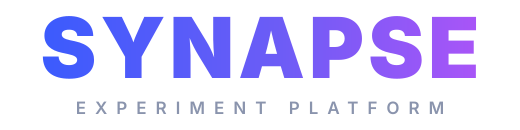
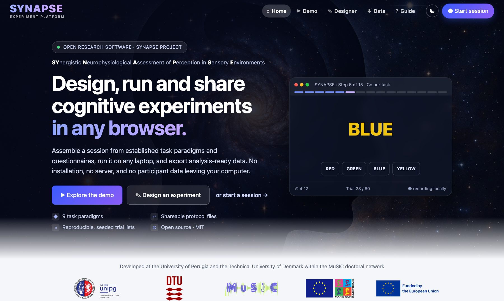
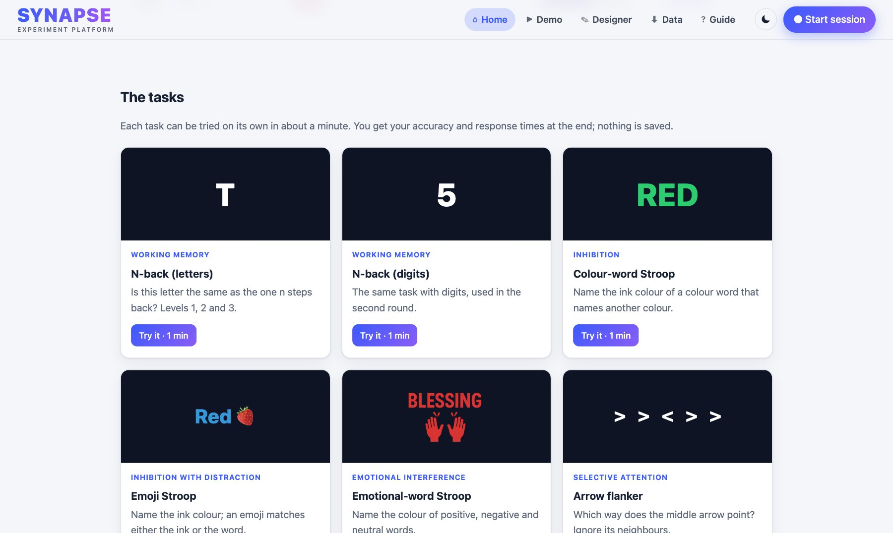
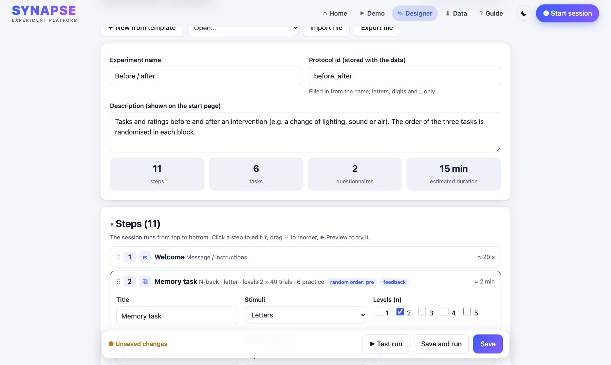
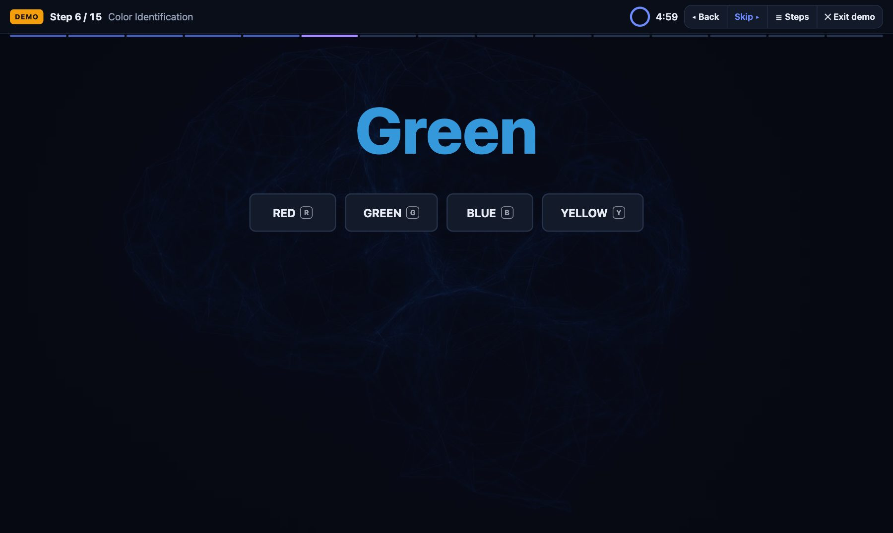
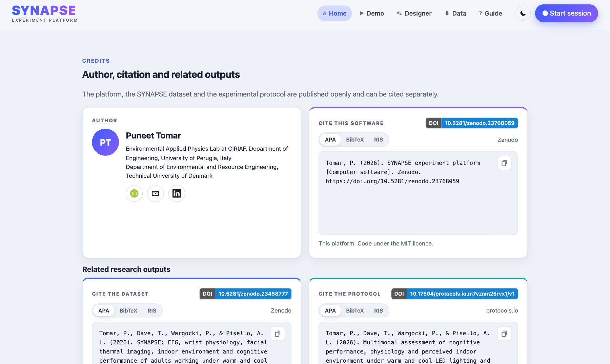

<div align="center">



### Design, run and share cognitive experiments in any browser

*SYNAPSE: Synergistic Neurophysiological Assessment of Perception in Sensory Environments*

[](https://synapse.ptomar.com)
[](https://doi.org/10.5281/zenodo.23768059)
[](LICENSE)

[**Open the platform**](https://synapse.ptomar.com) · [**Try the demo**](https://synapse.ptomar.com/#/demo) · [**Design an experiment**](https://synapse.ptomar.com/#/designer) · [Documentation](docs/documentation.md) · [Cite](#cite)

<br>



</div>

---

SYNAPSE is an open, browser-based platform for cognitive experiments. Assemble a session from established task
paradigms, questionnaires, rest baselines and soundscapes; run it on any laptop; and download analysis-ready data.
**No installation, no server, no account, and no participant data leaving the computer.**

It was built for the SYNAPSE study at the Technical University of Denmark (2025), which examined how lighting colour and
urban soundscapes affect cognition, physiology and perceived comfort. The complete study session is included as a
ready-to-run protocol.

## ✨ Highlights

| | |
|---|---|
| 🧠 **Nine task paradigms** | N-back (letters, digits), colour-word, emoji and emotional-word Stroop, arrow and digit flanker, visual counting, shape comparison |
| ✎ **Experiment designer** | Templates, drag-and-drop steps, trial numbers, time limits, practice trials with feedback, your own instructions and questionnaires |
| ⇄ **Counterbalancing** | Session conditions, random-order groups, soundscapes and colour themes that follow a condition |
| ⬇ **Analysis-ready data** | One ZIP per session or all sessions combined: trials, questionnaire answers and an event log as CSV, plus a JSON with the protocol and seed |
| ⟲ **Reproducible** | Seeded trial lists, the protocol stored with every session, shareable protocol files |
| 🔒 **Private by design** | Runs entirely in the browser; data stay on the computer until you download them |

## 🖼️ A look inside

<table>
  <tr>
    <td width="50%"><br><sub><b>Task gallery</b> — live previews and one-minute try-outs</sub></td>
    <td width="50%"><br><sub><b>Experiment designer</b> — templates, steps, practice and feedback</sub></td>
  </tr>
  <tr>
    <td width="50%"><br><sub><b>Running session</b> — progress bar, timer and researcher controls</sub></td>
    <td width="50%"><br><sub><b>Open science</b> — cite the software, dataset and protocol</sub></td>
  </tr>
</table>

## 🚀 Get started

**Use it online:** open **https://synapse.ptomar.com** and choose *Explore the demo*, *Design an experiment* or *Start a session*.

**Run it on your own computer** (e.g. offline in a lab): download this repository and serve the folder with any static web server:

```bash
git clone https://github.com/tomarp/synapse-platform.git
cd synapse-platform
python3 -m http.server 8000      # then open http://localhost:8000
```

A five-minute walk-through is on the platform's **Guide** page. Protocol and questionnaire formats, the data dictionary and
the test suite are described in the [documentation](docs/documentation.md).

## 📚 Cite

If you use SYNAPSE in your research, please cite the software:

> Tomar, P. (2026). *SYNAPSE experiment platform* [Computer software]. Zenodo. https://doi.org/10.5281/zenodo.23768059

<details>
<summary>BibTeX</summary>

```bibtex
@software{tomar_2026_synapse_platform,
  author    = {Tomar, Puneet},
  title     = {{SYNAPSE} experiment platform},
  year      = {2026},
  publisher = {Zenodo},
  doi       = {10.5281/zenodo.23768059}
}
```
</details>

Related outputs of the SYNAPSE study:

- **Dataset**: Tomar, P., Dave, T., Wargocki, P., & Pisello, A. L. (2026). *SYNAPSE: EEG, wrist physiology, facial thermal
  imaging, indoor environment and cognitive performance of adults working under warm and cool LED lighting and urban
  soundscapes* [Data set]. Zenodo. https://doi.org/10.5281/zenodo.23458777
- **Protocol**: Tomar, P., Dave, T., Wargocki, P., & Pisello, A. L. (2026). *Multimodal assessment of cognitive performance,
  physiology and perceived indoor environment under warm and cool LED lighting and urban soundscapes (SYNAPSE)*.
  protocols.io. https://doi.org/10.17504/protocols.io.m7vznm25rvx1/v1

GitHub's **Cite this repository** button (right sidebar) reads the same information from [`CITATION.cff`](CITATION.cff).

## 👤 Author

**Puneet Tomar**: Environmental Applied Physics Lab at CIRIAF, University of Perugia, and Department of Environmental
and Resource Engineering, Technical University of Denmark.

[ORCID](https://orcid.org/0000-0002-5168-5471) · [E-mail](mailto:puneet.tomar@proton.me) · [LinkedIn](https://www.linkedin.com/in/tomarp/)

Questions, ideas and bug reports are welcome as [GitHub issues](https://github.com/tomarp/synapse-platform/issues).

## 🇪🇺 Funding


This project has received funding from the European Union's Horizon Europe research and innovation programme under the
Marie Skłodowska-Curie grant agreement No 101073357 (MuSIC).

## 📄 License

Code: [MIT](LICENSE). Task images and backgrounds are AI-generated (OpenAI GPT-4o, Microsoft Designer Image Creator).
The soundscapes are spectrum-matched noise substitutes for the original study recordings. Logos belong to their owners.
Details: [documentation → Media](docs/documentation.md#media) · [changelog](CHANGELOG.md).
